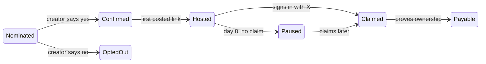

# Launch Title: Build Spec v1

13 November 2026

## Summary

The platform is a curated store for AI-made web games. Anyone tags a game on X, the creator confirms, we host it, it plays inside an app that feels like a console, and the creator keeps 80% of what it earns.

The product is called Launch Title. The app lives at `launchtitle.gg` and the bot is `@launchtitlegg`. "The platform" below means Launch Title.

**Principles the build must hold to**

- **Tool-agnostic.** We ship no creation tool. Games built with Claude, GPT, Cursor or by hand are all accepted.
- **Consent before copy.** We never host a copy of a game until its creator confirms from their own X account.
- **Isolation.** Game code never runs on the platform's main domain.
- **Curation is the product.** Everything confirmed gets a page; only curated games enter the store.
- **No single-rail dependency.** X is the main trigger and a payout option, and each has a web fallback.
- **Zero work to list.** Version 1 needs no SDK and no code change from the creator.

**Out of scope for version 1:** downloadable or native games, multiplayer infrastructure, ads, per-game tokens, and games that need their own server (those are embed-only).

## User flows

A game moves through five states, and each one unlocks more. The creator's own X account is the key at every step.

A creator who says no is opted out for good. A hosted game that is not claimed by day 8 pauses until the creator signs in.

**Creator adds their own game**

1. The creator replies `@launchtitlegg add` under their own post that contains the game link.
2. The bot checks that the reply author and the post author are the same account.
3. The game is imported, tested and published to the open shelf. The bot replies with the page link.

**Someone else nominates a game**

1. A nominator replies `@launchtitlegg add @creator` under a post that contains the game link.
2. The bot creates a page that links out to the original, and waits.
3. The creator replies `yes` from the tagged account. The game is embedded, and imported if the creator first posted the link.
4. If the creator replies `no`, the game is opted out for good.

**Play, claim and get paid**

1. Players open the game inside the console app. Qualified playtime is recorded.
2. Hosting is free for 7 days. Earnings accrue as a reserved credit.
3. The creator signs in with X and accepts the terms to keep the game hosted.
4. The creator proves ownership of the game and adds payout details. Payouts start.

## X bot

The bot is a thin client of the same API the web form uses. It only ever replies inside a thread where it was tagged.

| Who posts | Post | Result |
| --- | --- | --- |
| Creator, under their own post with a game link | `@launchtitlegg add` | Confirmed at once; import starts |
| Anyone, under a post with a game link | `@launchtitlegg add @creator` | Nomination; bot waits for the creator |
| Tagged creator, replying to the bot | `yes` | Listing confirmed |
| Tagged creator, replying to the bot | `no` | Permanent opt-out for that game |
| Creator | `@launchtitlegg remove` | Listing and hosted copy taken down |

**Conversation rules**

- The bot never starts a thread and never mentions an account the nominator did not tag.
- A missing game link or missing creator tag gets one clarifying reply. The nomination expires after 24 hours if it is not fixed.
- If the parent post holds several links, the bot asks which one.
- One nudge at most per nomination.
- Accounts are matched on X account ID, never on handle, because handles change.
- A duplicate game URL gets a reply with the existing page link.

**Limits**

- 5 nominations per account per day.
- One open nomination per game URL.
- Every action is idempotent on the X post ID, so a retried job cannot double-list a game.

**Web fallback**

A `/submit` page does everything the bot does, using Sign in with X. If X API access is lost or repriced, the platform keeps working.

## Verification tiers

Control of an X account and ownership of a game are separate proofs. Each tier asks for only as much proof as the action needs.

| Tier | State | Unlocks | Proof required |
| --- | --- | --- | --- |
| 0 | Nominated | A page that links out to the original | None |
| 1 | Confirmed | Embed on the open shelf | `yes` reply from the tagged account ID |
| 2 | Hosted | Imported copy on our CDN; earnings start to accrue; store eligibility | Tier 1, plus the game link was first posted by that account, or the creator used self-add |
| 3 | Claimed | Hosting beyond 7 days; creator dashboard | Sign in with X as the same account ID; creator terms accepted |
| 4 | Payable | Payouts | A verification code served from the game's original URL, or publishing from a connected GitHub repo |

If two accounts claim the same game, earnings freeze and the case goes to manual review.

## Hosting and sandbox

Version 1 hosts static web games only: HTML, JavaScript, WebAssembly and assets. Games that need their own server are embedded, not imported.

| Mode | Source | Used when |
| --- | --- | --- |
| Embed | The creator's existing URL in a frame | Tier 1, or a game with its own backend |
| Import by crawl | Same-origin static files fetched from the game URL | Tier 2, default path |
| Import by upload | A zip file, or the build output of a GitHub repo | Crawl fails, or the creator prefers it |

**Import pipeline**

1. **Fetch.** Collect the files. Limits: 200 MB and 2,000 files per game.
2. **Scan.** Check for crypto-miner and malware signatures, and list every outbound domain the game calls.
3. **Store.** Save as an immutable, content-addressed version in object storage.
4. **Serve.** Publish at `{gameId}.<play-domain>`, on a separate registrable domain from the app.
5. **Boot test.** A headless browser loads the game at desktop and mobile sizes. It records time to first frame, console errors and memory.
6. **Capture.** Take 3 screenshots and a 6-second clip for the game page and the X card.
7. **Publish.** A pass goes to the open shelf. A fail falls back to embed, and the creator gets the report.

**Isolation rules**

- The play domain shares no cookies or storage with the app domain.
- The game frame gets `sandbox="allow-scripts allow-same-origin allow-pointer-lock"` and `allow="fullscreen; gamepad"`. It gets no top-navigation and no popups.
- The shell and the game talk only through `postMessage`, with a fixed message list.
- Outbound requests are allowed but logged. Known miner pools are blocked.

**Updates**

A creator re-runs `add` or pushes to the connected repo to publish a new version. Every version is kept, and rollback is one click.

## Console shell

The shell is what makes this a place to play and not a list of links. Everything in it works without the game's cooperation.

- **Installable app.** A web app that installs and launches full-screen with no browser bar. A desktop wrapper comes later.
- **Three sections.** Store, Library, Creators. Each has its own colour (see `brand/brand-book.md`).
- **System layer.** The shell draws the boot animation, the loading screen and the pause overlay outside the game frame. The overlay holds resume, restart, tip the creator, report and exit.
- **Controller support.** The whole shell is navigable with a gamepad, with a visible focus ring and a large-screen layout.
- **Input badges.** Each game page shows keyboard and mouse, touch, or controller. The boot test detects them and the creator can override.
- **Identity.** Sign in with X or email. Guests can play; signing in saves the library and counts playtime toward payouts.

**Playtime heartbeat**

The shell sends a heartbeat every 15 seconds while three things are true: the game frame is visible, it has focus, and the player gave input in the last 60 seconds. Heartbeats are the only source of qualified playtime.

**Budgets**

- Shell JavaScript before the game loads: under 150 KB.
- Tap to first game frame for store games: under 5 seconds on a mid-range phone.

**Not in version 1:** achievements, friends and cloud saves. Each needs a script inside the game.

## Curation

There are two tiers, and moving from one to the other is a human decision. A curated store game is called a Launch Title.

| | Open shelf | Launch Titles (the store) |
| --- | --- | --- |
| Entry | Automatic: Tier 2 and a passed boot test | Hand-picked by a curator |
| Where it shows | Search, creator pages, direct links | The console home screen and Launch Day |
| Earns from the pool | Yes | Yes |

**Store criteria**

- Boots in under 5 seconds with no errors in the boot test.
- At least 10 minutes of real play.
- Fully playable with at least one declared input.
- Original or licensed art, code and characters.

**Curator queue**

The queue ranks shelf games by median session length, next-day return rate, share of players who pass 5 minutes, and report rate. The ranking only orders the queue. A person decides.

**Launch Day**

A fixed number of new Launch Titles each week, announced by the bot on X. Each one gets a permanent number (No. 001, No. 002 and so on). How many per week is an open question.

**Demotion**

A store game returns to the shelf if its build is broken for 48 hours, an IP complaint is upheld, or playtime farming is found.

## Money

Creators are paid from a weekly pool, split by qualified playtime. Creators keep 80% of everything a game earns, net of processing costs.

**Where the money comes from**

| Phase | Source | Split |
| --- | --- | --- |
| 1 | A fixed weekly pool funded by the platform | The whole pool goes to creators |
| 2 | Player tips, and a player subscription that feeds the pool | 80% creators, 20% platform, of net receipts |
| 3 | Ads | 80% creators, 20% platform, of net receipts |

**Pool rules**

- A week runs Monday 00:00 UTC to Sunday 24:00 UTC.
- A game's share is its qualified playtime divided by all qualified playtime that week.
- Shelf and store games at Tier 2 or above both earn.
- No game takes more than a capped share of one week's pool. The cap is an open question; 15% is the placeholder.

**Qualified playtime**

- Signed-in players only. Guest play does not count.
- At most 2 hours per player, per game, per day.
- Earnings are held for 7 days before they become payable, so farming can be reversed.
- Flagged sessions earn nothing: no input variation, many accounts from one device, or play only on the creator's own games.

**The 7-day window**

1. Hosting is free for 7 days from the moment a game reaches Tier 2.
2. Earnings in that time are a reserved credit, shown on the game page.
3. On day 8 without a claim, the hosted copy pauses. The page stays up with the reserved amount and a claim button, and falls back to embed where it can.
4. A reserved credit that is never claimed lapses. The period is an open question; 90 days is the placeholder.

**Payouts**

- Payouts need Tier 4 and payout details.
- Paid weekly, with a minimum of $10.
- Payout rails sit behind one `PayoutProvider` interface. Version 1 implements one rail; which one is an open question.
- The bot posts each payout publicly. A creator can hide the amount.
- In the product, creators see payouts as "royalties".

**Ledger**

A double-entry, append-only ledger. Every pool calculation must be reproducible from the stored playtime totals.

## Data model

Eleven tables cover version 1.

| Table | Holds | Key fields |
| --- | --- | --- |
| `users` | Players, creators, curators | `x_account_id`, `handle`, `email`, `role` |
| `games` | One row per game | `slug`, `source_url`, `creator_x_account_id`, `creator_user_id`, `state`, `tier`, `mode`, `store_status` |
| `nominations` | Each tag-to-add request | `game_id`, `nominator_x_id`, `post_id`, `parent_post_id`, `state`, `expires_at` |
| `versions` | Immutable imported builds | `game_id`, `storage_key`, `hash`, `size`, `boot_report`, `active` |
| `verifications` | Proofs behind each tier | `game_id`, `kind`, `evidence`, `verified_at` |
| `optouts` | Creators who said no | `source_url_hash`, `x_account_id` |
| `play_sessions` | Aggregated heartbeats | `game_id`, `user_id`, `started_at`, `qualified_seconds`, `flags` |
| `pool_weeks` | One row per weekly pool | `starts_at`, `amount`, `status` |
| `ledger_entries` | Every credit and debit | `account`, `game_id`, `pool_week_id`, `amount`, `kind`, `status` |
| `payouts` | Money sent out | `user_id`, `provider`, `amount`, `status`, `external_ref` |
| `reports` | Player and IP complaints | `game_id`, `kind`, `status` |

**Game states**

`NOMINATED`, `CONFIRMED`, `HOSTED`, `CLAIMED`, `PAYABLE`, with side states `PAUSED`, `OPTED_OUT` and `REMOVED`. State changes are written to an audit log with the X post ID or user ID that caused them.

## Stack and architecture

Two domains, one database, and every client going through one API.

| Part | Runs on | Talks to |
| --- | --- | --- |
| Console app and API | Next.js on Vercel, on the app domain | Database, queue, payout provider |
| Game delivery | Cloudflare R2 with a Worker, wildcard subdomains on the play domain | Object storage only |
| Database | Postgres | API and workers |
| Import and boot-test worker | A container with a headless browser | Queue, object storage, database |
| X bot | A worker that reads mentions and posts replies | X API, the platform API |
| Pool job | A weekly scheduled job | Database, ledger |
| Auth | Sign in with X (OAuth 2) and email link | X API, database |

**Rules for the build**

- The bot and the web form call the same API endpoints. No logic lives only in the bot.
- The play domain serves files and nothing else. It has no API and no session.
- Heartbeats are written to an append-only table and aggregated hourly into `play_sessions`.
- Every external service sits behind an interface: X, payouts, object storage. Tests run against fakes.

## Build order

Seven milestones, each with a check that must pass before the next one starts. Milestone 0 needs no product code.

1. **M0: Manual pilot.** Pick the 20 best AI-made web games on X. Ask each creator for consent by reply or message. Put them on one page.
   - Check: count how many creators say yes, and how many of the games import by URL alone.
2. **M1: Hosting core.** Import by URL and by zip, isolated subdomains, versions, a basic game page.
   - Check: 10 pilot games play on a phone and a laptop. A test proves a game frame cannot read app cookies or storage.
3. **M2: Console shell.** Installable app, Store, Library, Creators, pause overlay, controller navigation, heartbeat. Built to `brand/tokens.json` and the screens in `design/screens/`.
   - Check: the app installs on desktop and Android. Every screen is reachable with a controller alone. Heartbeat totals match a scripted session within 5%.
4. **M3: X bot and web submit.** All five commands, the confirm flow, limits, opt-outs.
   - Check: every command works end to end on a test account. Tests cover duplicates, expiry, opt-out and a wrong-account `yes`.
5. **M4: Claim and verification.** Sign in with X, tiers 3 and 4, the 7-day window, the creator dashboard.
   - Check: an unclaimed game pauses on day 8 and resumes on claim. A different X account cannot claim it.
6. **M5: Pool, ledger and payouts.** Weekly pool job, ledger, one payout rail, public payout posts.
   - Check: a pool run can be reproduced from stored playtime. A farming test account earns nothing.
7. **M6: Curation tools.** Curator queue, promote and demote, the Launch Day page.
   - Check: a curator can run a full Launch Day without touching the database.

**After version 1:** tips, publish-from-agent command and connector, a save and leaderboard script, metered AI inference, player subscription, ads.

## Legal and policy

These must exist before the first imported copy goes live, and the payout items before the first payout.

- [ ] Creator terms: a non-exclusive licence to host, display and promote; a warranty that the creator holds the rights; the revenue share; removal at any time.
- [ ] Player terms and privacy policy, covering X account IDs and playtime data.
- [ ] Takedown policy with a named contact, a repeat-infringer rule and a counter-notice route.
- [ ] IP policy for remixes, decompiled games and fan games. Default: not store-eligible without proof of rights.
- [ ] Pre-claim earnings written as a conditional credit that lapses, and checked by payments counsel in the operating jurisdiction.
- [ ] Payout compliance: identity checks, tax forms and sanctions screening, handled by the payout provider where possible.
- [ ] Review of X's developer terms and automation rules for the bot.
- [ ] Age and content rating policy.
- [ ] Operating entity and jurisdiction chosen.

## Open questions

**Decisions**

- [ ] A separate play domain for serving the games.
- [ ] Payout rail for version 1: card payouts, stablecoin, or both.
- [ ] Size of the weekly pool in phase 1.
- [ ] Per-game cap on one week's pool (placeholder 15%).
- [ ] Lapse period for unclaimed credit (placeholder 90 days).
- [ ] Number of games in each Launch Day, and who curates.

**Facts not yet verified**

- [ ] Current X API tier and cost for reading mentions and posting replies.
- [ ] Whether X Money is open to third-party payouts.
- [ ] Share of pilot games that import cleanly by URL alone (measured in M0).
